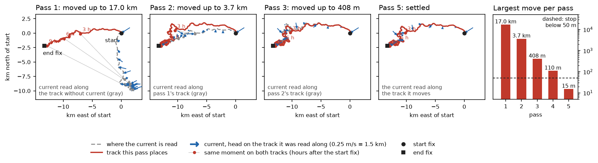

Ocean currents and track comparison
===================================

A deployment can carry several reconstructions of the same tag data. They differ in how the
track is placed and in whether the ocean current was added. A track is either dead-reckoned
from the start fix, or pinned (stretched and turned so that it ends on the end fix). The
biologger-sim documentation explains the method
(`Tracks and ocean currents <../sim/tracks.html>`_). This page explains what the portal shows.
Code links point to lhzn-io/biologger-portal on GitHub at the commit used to build this guide.

How the current enters a track
------------------------------

The tag records how the animal swam: its heading, its depth and how hard it worked. It does not
record where the water carried it. Dead reckoning adds up the swim from the start fix, one
sensor sample at a time. The current correction adds up the water's drift the same way: at
each moment, the model current at the animal's position, depth and time (read once a minute and
interpolated between), times the time step. The current therefore changes along the track,
with the tide and with place, and the drift at any moment is the sum of all the current before
it. A pinned track then stretches and turns the swim, never the drift, so that the track ends on
the end fix.

That is a chicken-and-egg problem. To read the current, you need to know where the animal was;
to know where the animal was, you need the current. Near the shelf break it matters: the model
current there changes over a kilometer or two, and a track can be off by more than ten. So
biologger-sim settles it in passes:

1. Read the current along the best track so far. On the first pass that is the track without
   any current.
2. Place the track again with that current.
3. If no point on the track moved more than 50 m since the last pass, stop. Otherwise go back
   to step 1 and read the current along the new track.

         line is where that pass read the current, blue arrows are the current, and a red line
         is the track the pass placed. The red track moves less each pass, and the bars fall
         from 17.0 km to 15 m.

   The RED001 swordfish track, pinned to both fixes, with the NECOFS current. Pass 1 reads the
   current along the track without current (gray) and places a new track (red); pass 2 reads it
   along that red track, and so on. Dots joined by a dotted line mark the same moment (3, 6 and
   9 hours after the start fix) on both tracks: where the current was read, and where the pass
   then put the animal. By pass 5 the track moves only 15 m, so the current is read where the
   track is drawn. Kilometers from the start fix.

Each pass moves the track less than the one before, usually by two to five times, so a
deployment of a few hours settles in a handful of passes and a multi-day one in more: the whale
shark took 22. A track that has not settled after 30 passes is kept and marked "not converged".
The simulator documentation gives the full method and its settings
(`Where the current is sampled <../sim/tracks.html#where-the-current-is-sampled>`_).

Each pass adds the current before it places the track on the fixes. A pinned track therefore
ends on the end fix with or without the current. For pinned tracks, the current changes the
shape of the path and how much stretching and turning the pinning needs, but not where the
track ends.

Each current-corrected track names its ocean model, and the track's name carries it
(``pin_cur_necofs``, ``pin_cur_doppio``). NECOFS (FVCOM, UMass Dartmouth) covers the Northeast
shelf and resolves the shelf break with triangles about 1.5 km on a side, finer along the slope
and the canyons. HYCOM covers the open ocean where NECOFS has none. The Rutgers DOPPIO model,
with cells of about 7 km, is run beside NECOFS on some deployments to show how much the answer
depends on the model. No model is a measurement, and none resolves well a canyon only a few
kilometers wide. Credit the model shown (NECOFS/UMASSD, DOPPIO/Rutgers, HYCOM) wherever the
portal shows a current.

The current on a track page
---------------------------

When a track was exported with the current correction, its track page adds:

- **Ocean current at the animal (m/s)**, a chart below the other charts. It shows the speed of
  the model current used to correct the track, and the current's eastward and northward
  components. The chart's summary gives the median and 95th percentile speed. Stretches where
  the model had no value (on land, below the model's seafloor, or outside its grid) are shaded,
  and the track used still water there. The chart's note names the ocean model that was used
  (for example NECOFS or HYCOM). (:src:`web/src/viewer/Charts.tsx`)
- **Ocean current speed**, a track coloring in the scene controls. The track is drawn from pale
  green at zero to dark green at the top of the scale, averaged over each drawn stretch, and
  gray where the model had no value. The top of the scale is the 98th percentile of the stretch
  means, rounded up to a step of 0.05, 0.1, 0.25, 0.5 or 1 m/s so that the legend has at most
  five ticks. The legend, "Ocean current (m/s)", names the model and the averaging time.
  (``currentScale`` and ``currentColor`` in :src:`web/src/viewer/current.ts`)
- The readout at the playhead, "Ocean current (model)", gives the speed of the current and the
  direction in which it flows.
- **Vertical ocean current at the animal (cm/s, up positive)**, a chart after the current chart,
  and "Vertical current (model)" in the readout and the 3D view's hover readout, when the model
  gives one (NECOFS does, HYCOM does not). It is the model's upward velocity at the animal's
  depth, in cm/s because it is far smaller than the horizontal current: along RED001 about
  0.1 cm/s at the median, against about 7 cm/s horizontally; over the shelf break the model
  reaches a few cm/s. It is shown, not applied: the track's depth comes from the pressure
  sensor. The current arrows tilt with it, exaggerated like the depth (see the guide's "Current direction"),
  and the physics inspector's current arrow includes it. (``verticalCurrentSeries`` in
  :src:`web/src/viewer/Charts.tsx`)

All of these show the model current at the model's resolution, not a measurement. A track without
the correction shows none of them, and its controls say so.

Comparing reconstructions
-------------------------

A deployment with more than one track links to ``/deployments/<id>/compare`` ("Compare the N
tracks"). The page has three parts (:src:`web/src/routes/ComparePage.tsx`, with the numbers
from :src:`web/src/viewer/compare.ts`).

**The table**, one row per track. Tracks with a pipeline record are shown, except dead
reckoning: unpinned, it drifts kilometers from the fixes, so it is listed but hidden until you
tick it. Older exports, labeled "earlier export, no pipeline record", are hidden the same way.
When every recorded track is dead-reckoned, those are shown; when no track has a pipeline record,
all tracks are. Click a row to put the animal on that track.

.. list-table::
   :header-rows: 1
   :widths: 25 75

   * - Column
     - Meaning
   * - Track
     - Its label from the pipeline record (placement, and current model if any), its color,
       and its run ID, linked to the track page
   * - Current
     - The ocean model, and the share of the record where it had no value
   * - Current drift at end
     - How far the current alone moved the track by the end of the record, and the bearing of
       that drift
   * - Miss before pinning
     - Distance from the dead-reckoned track (with the current, when applied) to the end fix
       at the fix's time (``end_fix_miss_before_placement``)
   * - Pinning
     - The stretch (scale) and turn (degrees) that pinning applies to bring the track onto the
       end fix
   * - Below seafloor
     - Share of the samples over the fused DEM (digital elevation model) that lie more than
       10 m below the DEM surface, and the deepest of them. A reconstruction that puts dives
       inside the seabed is wrong there.
   * - Simulator
     - The biologger-sim commit that made the track, marked if the tree was dirty

**The 3D view.** The selected track carries the animal. Every other visible track is drawn in
its own color, with an outlined dot at the same moment, so the gap between reconstructions shows
as they play. A track's color is the ocean model that moved it, and its line style is how it was
placed, so one model's tracks share a color and two models never do:

- No current: lavender.
- NECOFS: salmon. DOPPIO: lime. HYCOM: orange. Any other model: lemon.
- Dead-reckoned tracks are dashed (in the 3D view, the distance chart and the legends); pinned
  and fix-to-fix tracks are solid.
- Older exports: grays.

The colors come from ColorBrewer's Set3, less its teal, blue and gray: light enough to stand out
on the shaded terrain and the dark panels, and none of them blue or cyan
(``variantColor`` in :src:`web/src/viewer/compare.ts`).

Controls for play, speed and vertical exaggeration, and a time slider, sit under the view.

**Along the tracks**, two charts on the shared timeline:

- The animal's depth against the seafloor under each track. Where a track's seafloor line
  rises above the depth line, that track has the animal inside the seabed.
- Each track's distance from the selected one over time.

You can collect the table and each chart, with their numbers as text (see "Collect, then ask
your AI").

Reading the comparison
----------------------

- The **miss before pinning** of the dead-reckoned tracks is the accumulated error of the tag
  alone. If the current-corrected miss is smaller, the current may explain part of it, but see
  the last point.
- Pinned tracks end on the end fix by construction, with or without the current. Compare their
  **pinning** instead. A scale near 1 and a small turn mean that the reconstruction needed
  little forcing to meet the fix.
- The **below seafloor** share is an independent check, because no reconstruction uses the
  seafloor in its fit.
- biologger-sim samples the current in passes, each along the track the previous pass placed,
  until the placed track stops moving. Check the ``current_correction`` step in the track's
  pipeline record. If ``converged`` is false, the passes ran out before the track settled, and
  the current was sampled up to the last pass's shift (``pass_shift_max_m``) away from the drawn
  track. Keep that distance in mind before crediting a smaller miss to the current. The
  simulator's documentation describes the passes and gives the RED001 figures
  (`Where the current is sampled <../sim/tracks.html#where-the-current-is-sampled>`_).
